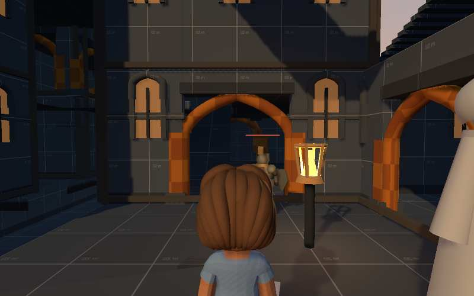
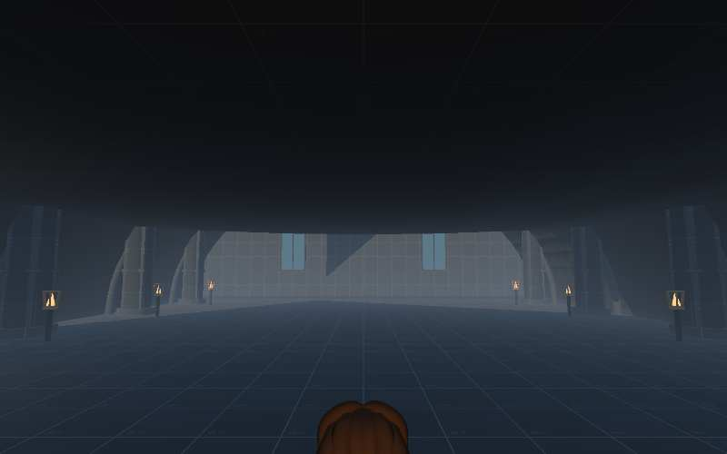
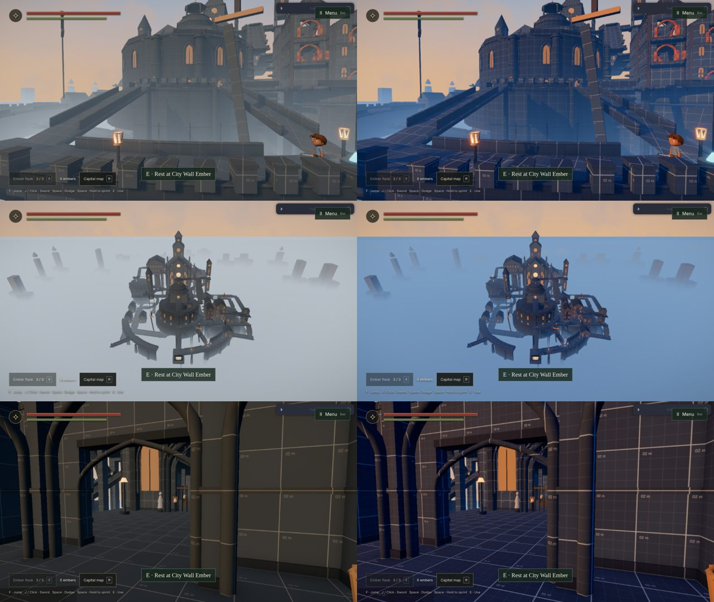
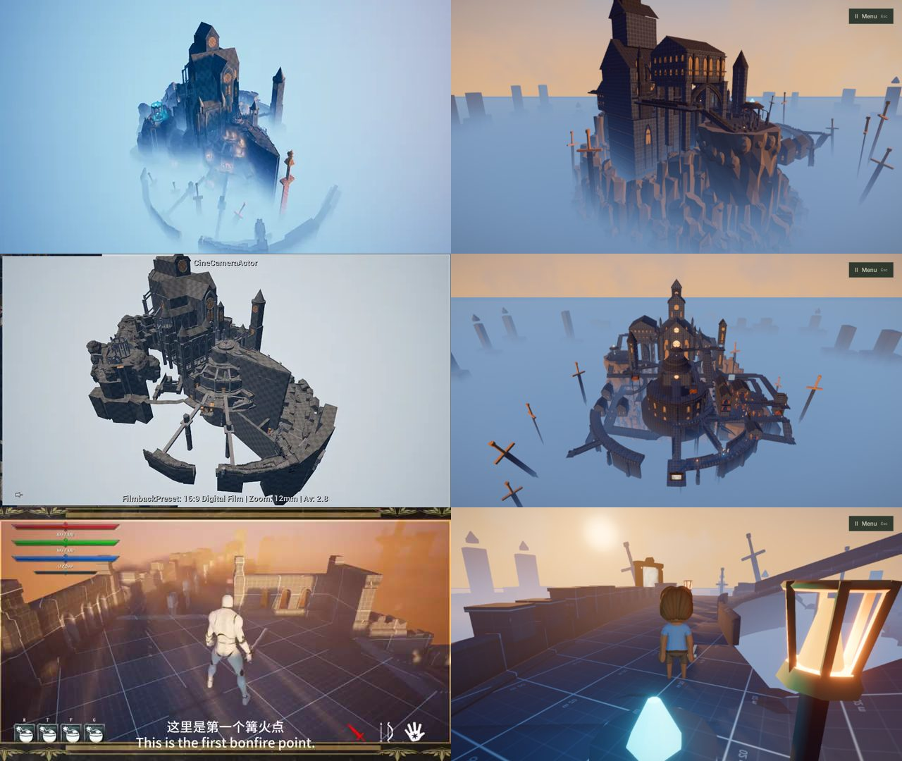
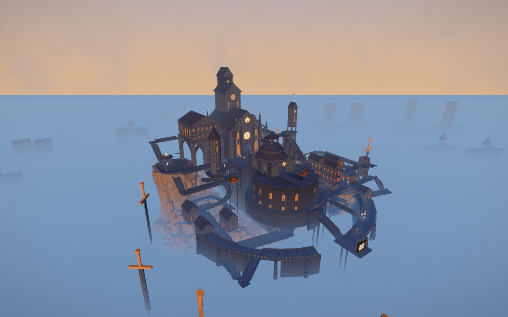

# Portal capital reconstruction

The Souls-like portal at `/boss` now uses an authored reconstruction of the [34:45 reference playthrough](https://www.youtube.com/watch?v=XhdRSTb7Tro). Reference frames sampled throughout the video are retained in `references/minas-tirith/video/`; the route plans and overview images are retained alongside them.

The reconstruction uses Three.js geometry and the existing player and combat system. It is not an import of the original Unreal level or its assets. Dimensions, the character, and some connecting passages differ from the footage; the screenshots below document the actual implementation rather than asserting an exact visual match.

## Layout changes

- The opening checkpoint sits on the broken curtain-wall arc, with a camera facing along the route, a torch cage and a hooded memorial statue. Respawns restore this orientation.
- The town is east of the chapel; the royal garden remains west of the cathedral. Building doors, floor layers, enemy spawns, rewards and navigation move together. Layout records are copied before transformation so development reloads cannot reverse the source data twice.
- The chapel and plaza have solid masonry podiums rather than unsupported decks. Foundations leave every lift shaft open; broad descending retaining steps support the eastern edge of the town. The sloping central retaining wall leaves both town approaches clear.
- The town has a cellar key room, three inhabited floors, visible stair treads and an enclosed lift between its lower and upper floors. The mountain key releases this lift; recall works from either landing and release persists after retry.
- The royal garden returns through a passage beneath the plaza and around the town perimeter. This replaces the overlapping connection on the old side of the town.
- The cathedral has an interior stair from the nave to the gallery, a clear aisle between physical pew banks, side chapels, roof routes and a return gate that opens from inside.
- The later descent and forgotten street occupy the opposite side of the lower city to avoid intersecting the relocated town foundations. The original spiral, house interiors, wall return and lower lift remain traversable.
- The final chamber is rectangular and enclosed, with a barrel vault, clustered piers, doorway and open lift bay. Its roof fits beneath the upper terraces.

A shared two-metre line grid covers the dark stone, with orange checker door surrounds, pale hooded statues and warm torch cages. Rendered steps sit beneath continuous collision ramps. The dusk sky uses warm cloud and horizon colors; cool height fog conceals the lower city until the beacon is lit. Distant building clusters continue the skyline beyond the playable walls.

## Progression

City Wall → Middle Town → cellar key → mountain passage → chapel checkpoint → cathedral galleries and western oratory → Keeper of the Asylum → crown beacon → revealed descent → forgotten street → final chamber.

Optional branches include the town lift, royal garden, roof chapel, side chapel, offerings, opened cathedral return and wall shortcuts. Keys, offerings, released lifts, opened gates, checkpoint choice, beacon state and boss victories survive retries. Ordinary enemies and lift positions reset with the encounter.

## Implementation

`capitalLayout.ts` owns floor polygons, physical solids, navigation and gameplay anchors. `capitalDistricts.ts` authors the building interiors and connecting routes. `capitalMassing.ts` supplies the closed foundations and shaft cuts. `capitalReferenceDetails.ts` supplies statues, visible steps and distant silhouettes. `capitalEnvironment.ts` renders and batches the architecture, shares collision geometry and applies height fog. `CapitalSky.tsx` renders the static cloud field. `capitalProgress.ts`, `SacredCapital.tsx` and `realm.tsx` connect this layout to interaction, physics and combat.

The 0.42 m radius player capsule traverses continuous collision ramps. Moving lift platforms use kinematic bodies and travel at 3 m/s. Static architecture remains batched by material and spatial cell; nearby point lights are bounded. Resource disposal remains idempotent.

## Validation

- Dependencies installed with `vp install`.
- `vp check`: zero errors; 130 existing warnings.
- `vp run typecheck` and `vp run build`: pass.
- `vp run test`: 310 tests pass, including 34 capital checks.
- Built-in `vp test` reports “No test suite found” for the repository's `node:test` files; `vp run test` invokes the configured test runner.

Capital checks walk the real Rapier player capsule across the opening arc, both exposed bridges, town cellar and three floors, both town lift landings, tunnel, cathedral stair and galleries, oratory, rafters, roof chapel, garden return, spiral descent, street interiors and final entrance. They also verify navigation to every offering, shaft clearance throughout lift travel, gate sidedness, retry persistence, combat floor separation and resource disposal.

The following images are direct WebGL renders captured through the native collaborative browser with inspection cameras. They show geometry and atmosphere; they are not screenshots of a human combat playthrough. Inspection teleport state is reset to the opening checkpoint after capture.

## Further silhouette correction

The chapel's polygonal roof is narrower, retaining its reachable roof terrace. The eastern retaining wall is now six metres wide, with a continuous sloping crown connecting the third cathedral level to the upper court. A separate eastern clock tower has a reachable platform and a return to this crown. The wall's physical arcade leaves the entry terrace and town routes clear below it. Clock faces use subdued dial markers and hands rather than the bright rose motif on the two main tower faces.

A new Rapier capsule route checks the crown, clock platform and return. The route fixture allows gravity to settle after downhill arrivals before checking floor height; this verifies an actual landing rather than horizontal proximity alone. Existing cellar, town, garden and descent checks also pass.

This is an additional correction, not a claim of a one-to-one match. The current overview below uses a camera on the garden side so the western island and eastern tower can be compared with the article's overview. Remaining differences include some district proportions and the detailed cathedral façade.

## Video look pass

The palette and lighting now follow the playthrough rather than a neutral grey blockout. Grid faces are blue-steel with crisp pale-cyan two-metre lines and faint half-metre subdivisions. The sunset key light is lower and warmer, and is aligned with the sky's sun glow, so walls cast long raking shadows. Skylight and graded shadows are blue, and the height fog is a mid-blue haze instead of a pale wash. Lift decks use the amber checker of the door surrounds. Layout, collision and navigation are unchanged.

Left: before. Right: after.

## Mountain, swords and sunset

The capital now stands on one craggy mountain, as in the article's map and overview. `capitalCrag.ts` rasterizes every existing mesh and walkable surface into a map of the lowest architecture in each two-metre column. Jagged prisms and boulders are clamped two metres below that height, with a five-metre side margin. Toward the rim, peaks fall into the fog. The crag has no collider; a capital test builds it against every walkway and lift shaft and checks the clearances. The rock material has no blockout grid, so natural stone stays distinct from masonry, as in the footage.

Giant swords stand point-down in an inner and outer ring in the fog. Each needs open air from its buried point to its leaning pommel, so no reachable surface passes through a blade. This replaces three fixed swords; one stood inside the relocated town and pierced its floors.

Low sunset light shafts are enabled. The sky has a hot sun disc that bloom turns into glare, and the key light sits at the same low angle. From the opening checkpoint, the player looks into the sun along the wall, as in the first frame of the footage.

Left: reference (atmosphere shot, article overview and opening frame of the video). Right: current capital.

The district layout still follows the existing routes rather than the article overview exactly. In particular, the broad curved eastern retaining wall remains narrower than in the overview.

## Reference clearance pass

The supplied metrics chart has now been read at full size. For the 1.84 m player capsule, this pass uses 3 m hallway headroom, 4 m stair headroom, a minimum 1.5 m road or hallway width, and a clear 2 × 3.5 m doorway. Amber door surrounds now frame the full rectangular opening instead of placing an arch inside its upper corners.

The exterior cathedral ascent and eastern crown use landings that meet the flights at their edges. The rear cathedral arch and rafter tie beams clear the crossings above them. Town timber bands stop at door jambs, the cellar stair fits between the neighboring floor edges, and the garden return passes through the beacon well with headroom above both routes. Masonry closes the low space beneath interior stairs; the taller part of the nave stair remains open for the side-chapel crossing.

The roof return clears its flying buttress, the lower street return clears the curtain ribs, and the town lift lanterns sit against the shaft wall rather than in the landing passage. The eastern outer-wall arc is two metres wider to preserve walking space beside the town foundation.

Run `node --experimental-strip-types scripts/auditCapitalMetrics.ts` for an advisory audit of rendered geometry. It excludes solid foundations and places the capsule cannot stand, uses normal ray queries to detect thin ornaments, and reports limiting triangles. The current sampling finds no headroom, minimum path-width or door-size violations. This is not certification of every chart metric: room sizes, four-metre street and stair widths, and movement speeds are not audited by this script.

Validation: all 312 configured tests pass, including 36 capital tests. Door-shoulder regression checks fail when the old arches are restored. `vp check`, `vp run typecheck` and `vp run build` pass; lint still reports warnings. Built-in `vp test` cannot discover suites in the repository's `node:test` files, so `vp run test` remains the configured runner.

Current overview, captured with an inspection camera in the native collaborative browser:

