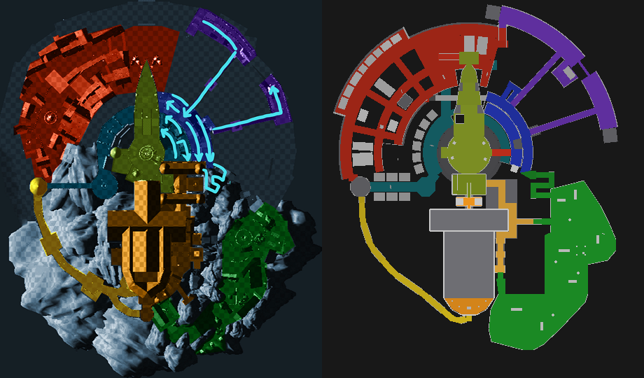
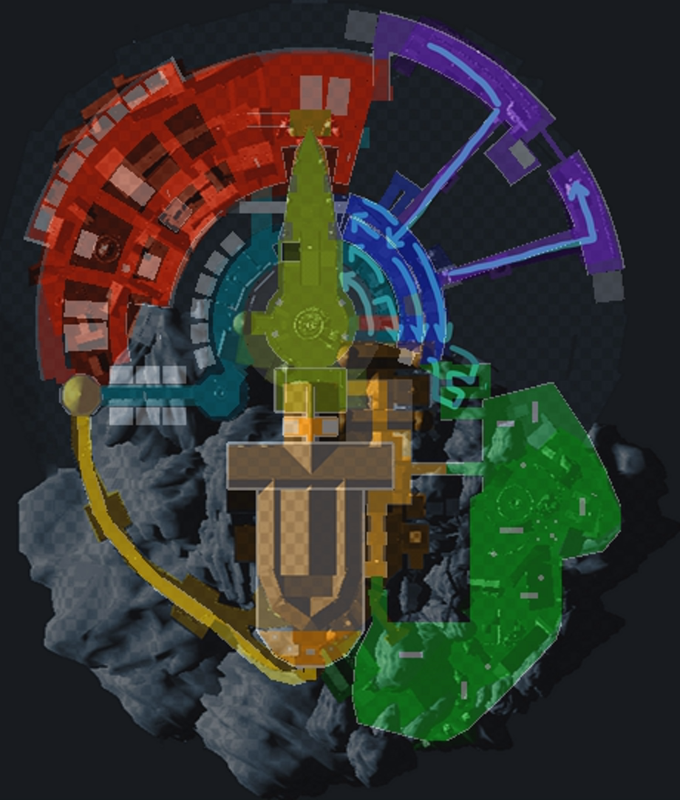
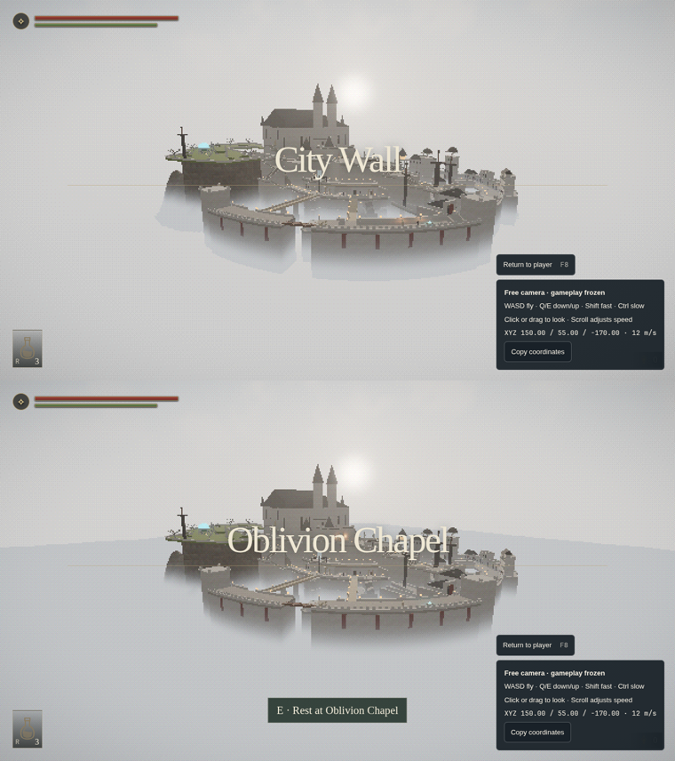
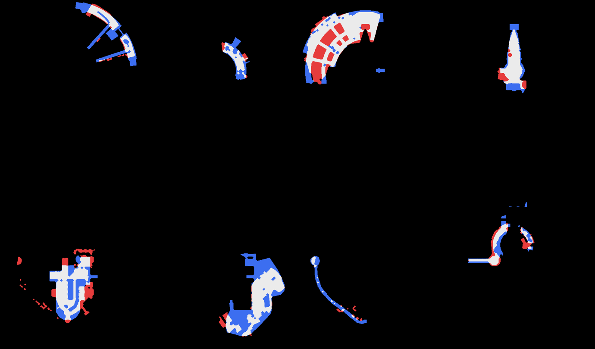
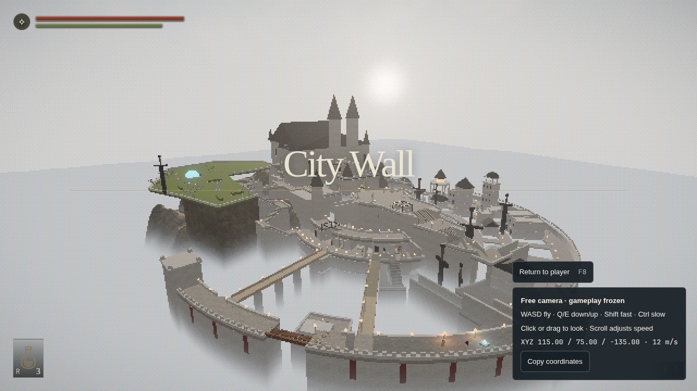
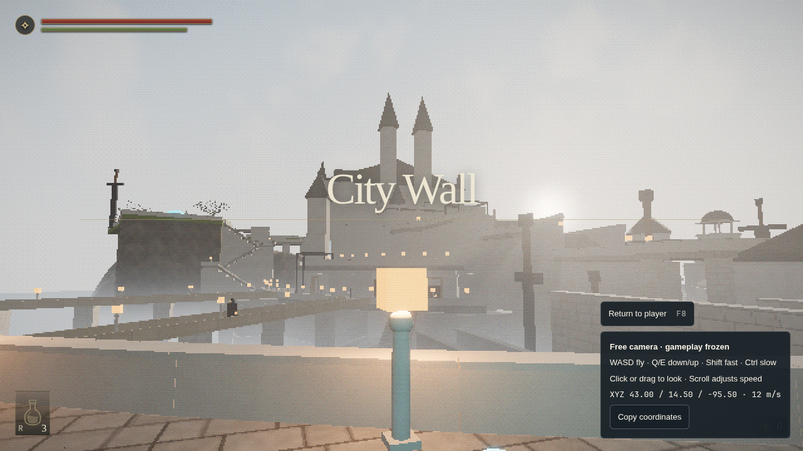
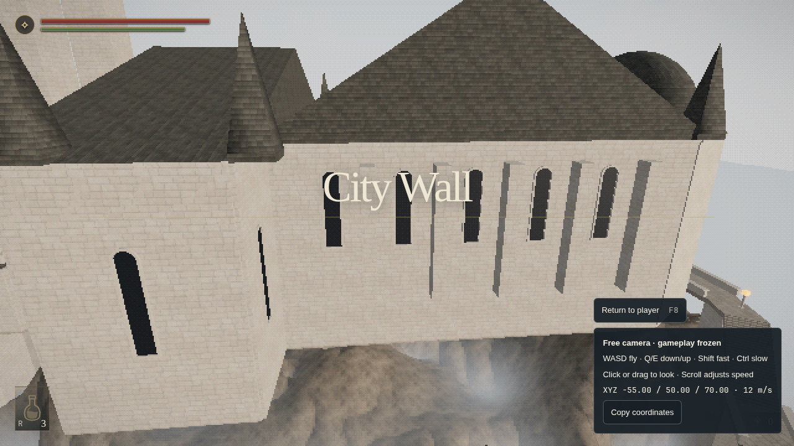

# The Fading Sacred Capital: Bramasole's Minas Tirith

The Souls-like boss world at `/boss` follows the level in [Bramasole's level-design article](https://medium.com/@bramasolejm030206/preface-ec08bc1459d0) ("Practice: Minas Tirith"). The sources were its area map, its two flowcharts, its 3D route diagrams and its whitebox and final renders, plus the author's [playthrough video](https://youtu.be/XhdRSTb7Tro). The article frames are in `references/minas-tirith/`.

It is a floating sky city split from its ground half by fog. The player climbs from the City Wall to the cathedral and throws the switch. As in the article's flowchart, the sky city comes down onto the ground and the missing lower half of the city joins it. The route then descends to the colosseum.

## Areas

North is −Z and the Ultimate Plaza is the origin. One pixel of the 1000 px area map is half a metre.

| Area (article)      | Here                                                                                                                                                                                                                                                                                   | Height       |
| ------------------- | -------------------------------------------------------------------------------------------------------------------------------------------------------------------------------------------------------------------------------------------------------------------------------------- | ------------ |
| City Wall           | Two curtain arcs in the north-east (radius 95–108). The start bonfire is on the first arc. The Break Wall breach has a fallen beam and a courtyard below with a stair back up                                                                                                          | 12           |
| Middle Level Town   | East ring. F2 is the street (39–46), where both long piered bridges land. F3 is the rooftop deck over the houses. F1 is the undercroft beneath the street, with the key room                                                                                                           | 9 / 15 / 3   |
| Mountain Tunnel     | From F1's north end through the prow, then across Grand Street's spur as a covered bridge                                                                                                                                                                                              | 3            |
| Up Town             | North-west quarter of house blocks, with inner, avenue and outer streets and radial lanes. It bulges to radius 100 on its west-north-west arc, wraps the north up to the prow, and reaches the great gate                                                                              | 6            |
| Top-Left Road       | Stair from Up Town to the tip platform of the prow                                                                                                                                                                                                                                     | 6 → 16       |
| Ultimate Plaza      | The blade walk climbs from the tip to the round plaza (radius 16), which has statues                                                                                                                                                                                                   | 16 → 24      |
| Top-Right Road      | From F3, through the key gate, up a stair-bridge to the plaza's east wing                                                                                                                                                                                                              | 15 → 24      |
| Oblivion Chapel     | South of the plaza: checkpoint, with doors to the plaza, the cathedral and the outside path. It has a walkable roof                                                                                                                                                                    | 24           |
| Asylum Cathedral    | Narthex, transept and nave hall with apse. Galleries (F2) are reached from outside; rafters (F3) run on to the chapel roof. The keeper is in the hall and the switch in the apse                                                                                                       | 24 / 31 / 38 |
| Church Outside Path | A ledge round the east flank, with stepping platforms up to the gallery door                                                                                                                                                                                                           | 24 → 31      |
| Royal Backyard      | A garden island in the south-east with the blue pavilion, its outline traced from the area map, including the tail sweeping west to the apse. Backyard Below is a switchback stair tower down to the town's south end                                                                  | 28           |
| Beacon Pathway      | West arc from the apse door down three flights to the beacon tower, sealed by fog until the switch is thrown                                                                                                                                                                           | 24 → 6       |
| Grand Street        | Below the fog. A bar runs from the beacon tower's foot to a junction, then a full ring round the central mountain's foot: west, north through an arch in the prow's keel past the arena lift, and east beneath the town. A spur runs north to the colosseum gate, under Up Town's deck | −8           |
| Glory Colosseum     | Under the plaza. Reached through the gate in the prow's keel; its lift rises to the blade                                                                                                                                                                                              | −18          |

## The switch: the sky city comes down

The flowchart's beat is: "the sky city falls down to the ground, and the missing pieces of city's bottom part reunion again".

- **Authoring.** Everything under the fog is authored as the ground city: Grand Street with its houses and swords, the colosseum and the plain (`b.groundLayer` in `capitalDistricts.ts`).
- **Rendering.** It is batched as its own group (`environment.ground`).
- **Before the switch.** The scene holds that group 240 m below its place, so the sky city floats alone on the cloud deck.
- **When the switch is thrown.** The ground city rises into place beneath it over seven seconds, with a rumble and a camera shake. From the sky city this is what falling onto the ground looks like.
- **Colliders** stay where they belong throughout; the ground is out of reach until the switch anyway.
- **Reduced motion and saves** that are already past the switch show the city settled.

## How closely the plan matches the area map

The article publishes no dimensions, heights or project files, so the area map is the only measurable source. I segmented each district on it by its colour and compared it with this level's walkable plan, rendered at the same 0.5 m-per-pixel scale. The comparison scripts were scratch tools, not part of the repo.

| District           | IoU  | Centroid offset (m) |
| ------------------ | ---- | ------------------- |
| Chapel and plaza   | 0.61 | 3.1                 |
| Up Town            | 0.60 | 4.6                 |
| Cathedral and path | 0.50 | 4.0                 |
| Royal Backyard     | 0.48 | 4.5                 |
| Middle Level Town  | 0.46 | 1.8                 |
| Grand Street       | 0.42 | 2.9                 |
| City Wall          | 0.37 | 6.6                 |
| Beacon Pathway     | 0.14 | 5.8                 |
| All districts      | 0.50 |                     |

The beacon arc is a hairline on the map, so its overlap score is not meaningful. By angle round the plaza, though, its radius matches the map to within 1–3 m:

| Angle (rad) | Map radius (m) | Here (m) |
| ----------- | -------------- | -------- |
| 3.4–3.6     | 101–111        | 101–110  |
| 3.6–3.8     | 100–103        | 98–104   |
| 3.8–4.0     | 97–99          | 94–100   |
| 4.0–4.2     | 89–95          | 87–96    |
| 4.2–4.4     | 83–87          | 76–88    |

Every district's centre sits within 2–7 m of the map's. The IoU figures understate the match: the map's shading hides parts of the green and blue districts from the colour segmentation, and the City Wall district here includes the Break Wall courtyard from the playthrough video, which the map does not colour.

Heights are not on the map. They come from the playthrough video and the whitebox renders, keeping the article's order: wall, then town, then the climb to the plaza and cathedral, then the descent to the ground and the colosseum.

## Flow

This follows the article's critical path:

1. City Wall, bridge, F2 street, F1 undercroft, Mountain Tunnel, Up Town, Top-Left Road, blade, plaza, Oblivion Chapel.
2. Then the outside path, the galleries, down to the transept, and the Keeper of the Asylum.
3. The switch lifts the fog.
4. The beacon pathway leads down to the tower, past its watch. The lift waits at the top and answers there once the fog has lifted; it is the only way down to Grand Street.
5. The court gate opens into the keel, and the corridor leads to The Ash Warden.

Loops and shortcuts:

- The cathedral front door, barred from the narthex, leads back to the chapel.
- The rafters reach the chapel roof.
- Backyard Below drops to the town street. Its garden door opens only from the garden, so the town has no back way to the cathedral: the first climb must reach the plaza and chapel. From the town the stair tower is a dead end with an offering on its upper landing.
- The undercroft key opens the town lift (F2 to F3) and the Top-Right Road gate.
- The great gate, unbarred from its stair, opens from Up Town's band onto the start wall. Grand Street reaches it through the beacon tower's lift and Up Town.
- The arena lift goes from the colosseum, west of its corridor, to the blade. It is released only from below.

### Flow against the article's method

Walking distances over the real floors, gates and lifts (`tests/capitalFlow.test.ts`):

| Route               | Before the shortcut | After | Shortcut       |
| ------------------- | ------------------- | ----- | -------------- |
| Start to chapel     | 318 m               | 184 m | Undercroft key |
| Chapel to town      | 250 m               | 183 m | Garden door    |
| Chapel to keeper    | 197 m               | 30 m  | Cathedral door |
| Start to Up Town    | 205 m               | 139 m | Great gate     |
| Chapel to colosseum | 456 m               | 153 m | Arena lift     |

- **Convergence.** On a fresh run nothing behind the chapel is nearer than the chapel itself.
- **Density.** Encounters follow the article's beat sheet. The plaza and chapel hold no enemies. The cathedral is the densest volume, with a watch on its floor, galleries and rafters. The descent to the last keeper is linear and holds under half the climb's enemies.
- **Open point.** The first descent from the chapel to the colosseum is 456 m with no checkpoint until the arena lift is released beside the boss door.

## Implementation

- `capitalDistricts.ts` authors every district with the kit builder (`capitalKitLevel.ts`), which records surfaces and colliders with each piece.
- `capitalLayout.ts` holds the gameplay anchors: areas, lifts, gates, shrines, caches, bosses, NPCs and enemies.
- `capitalCrag.ts` raises the rock: a central mountain under the plaza, an island under the cathedral and garden, and a shelf under Up Town. The wall, bridges and town stand on their own masonry piers.
- The cloud-deck shader in `capitalEnvironment.ts` hides everything below y ≈ 1 until the switch.
- A keeper now waits seven metres beyond its circle's centre, on the side away from the seal (`beginCapitalBoss`).

## Validation

- `vp run test` passes the whole suite.
- `tests/capital.test.ts` checks the logic:
  - the plan follows the article's area map;
  - the ground city is authored apart from the sky city;
  - anchors are on floors;
  - lift shafts are clear and the boss leash circles are open floor;
  - the metrics hold;
  - one walkable network;
  - gates, lifts, the fog seal and retries all behave.
- `tests/capitalFlow.test.ts` measures the routes above and checks the encounter curve.
- `tests/capitalRoutes.test.ts` builds the city and one Rapier world once. It walks the real player capsule along every route above, checks the blade's paving and parapets, and casts the boarding corridors of all six lift landings.
- That routes file runs in about 5 s.
- An earlier lift-landing check printed a Rapier hit object when it failed. That object references the whole physics world, and formatting it used several gigabytes. Assertions now compare primitives only.

The shots below are headless free-camera renders (`/boss?camera=x,y,z&look=x,y,z`), not played sessions: the overview from beyond the wall, the view from the start bonfire, and the cathedral's flank.

