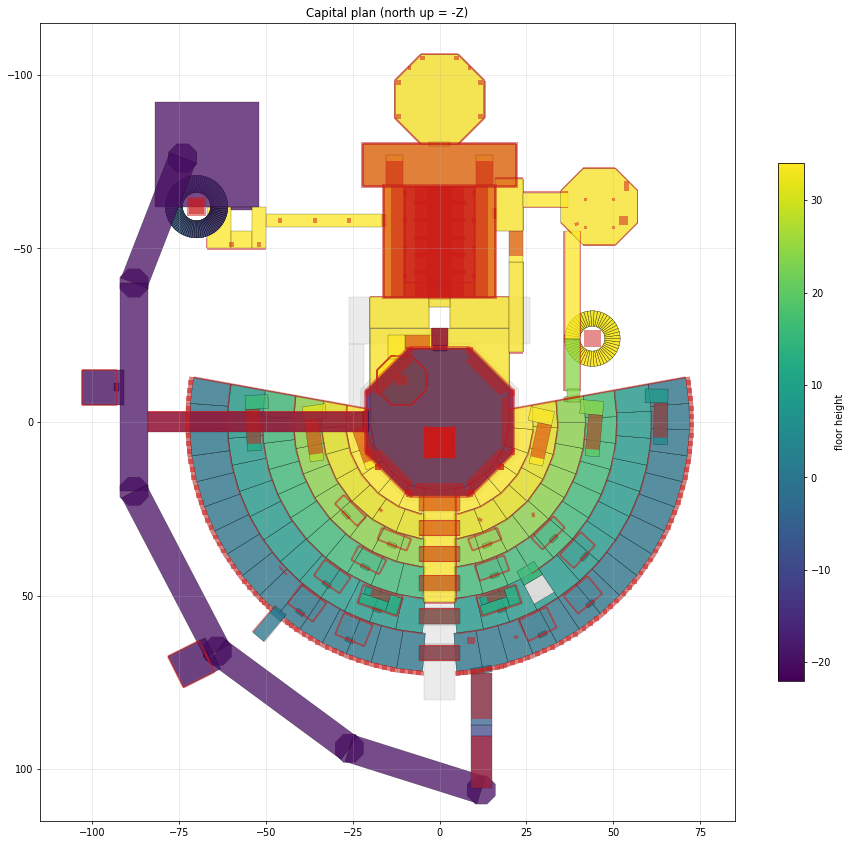
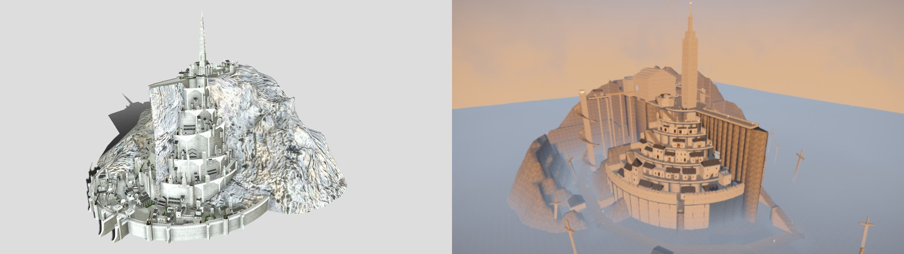
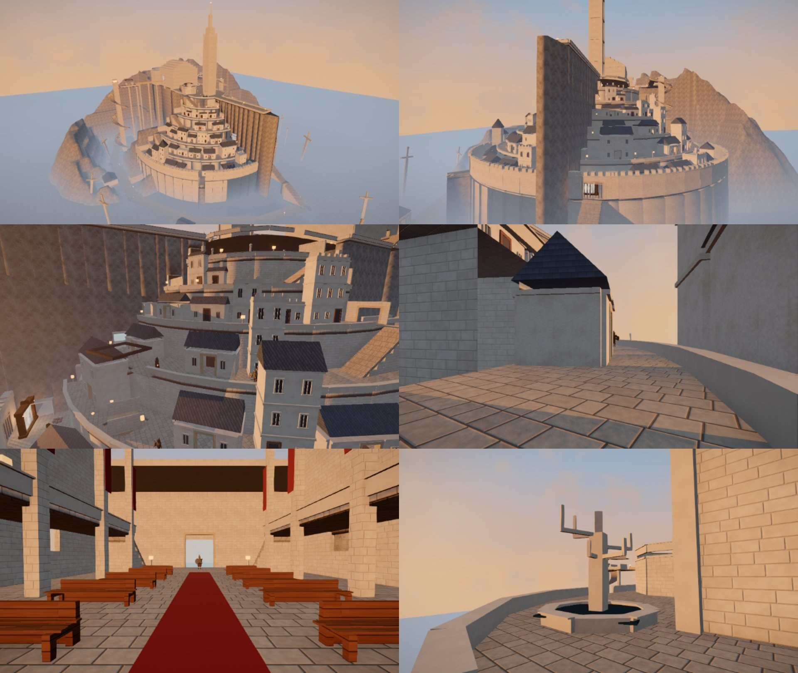
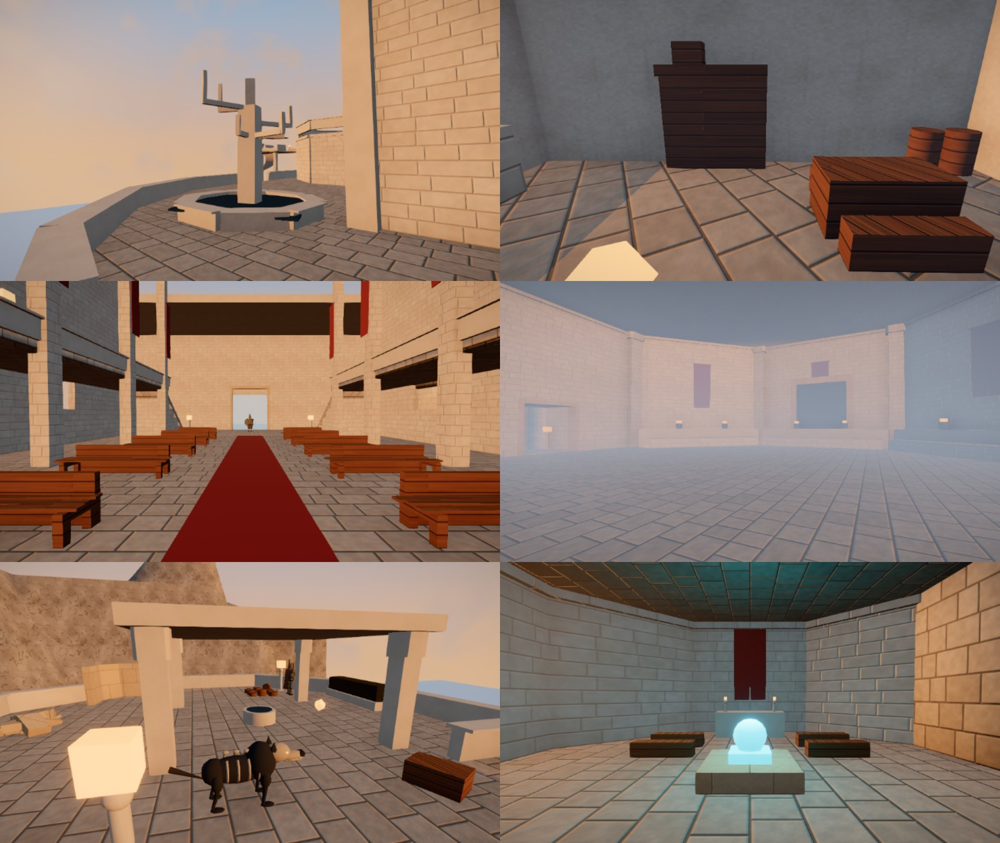
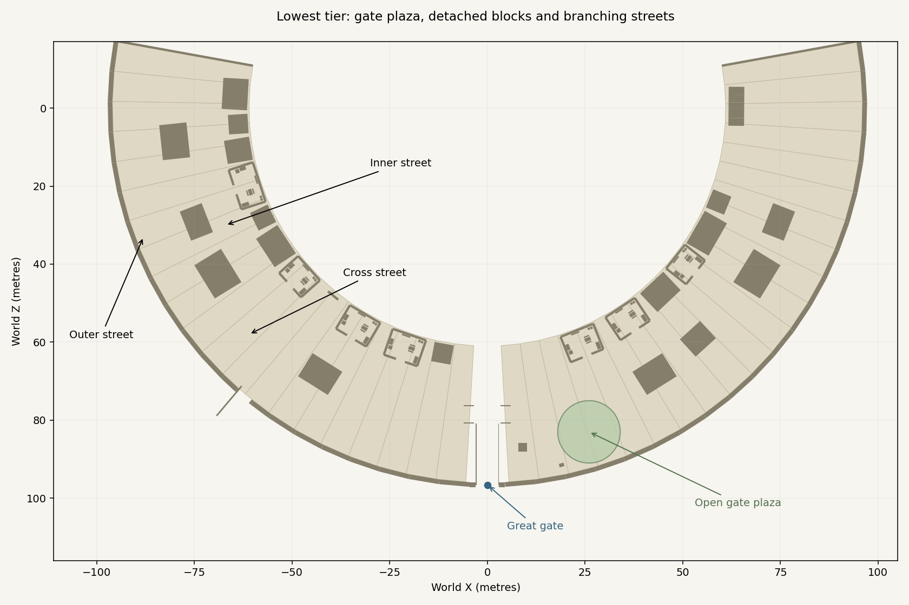

# The Fading Sacred Capital: seven-tier kit city

The Souls-like portal at `/boss` is built entirely from the blockout kit catalogued at `/capital-kit`. Its form follows the [Minas Tirith model on Sketchfab](https://sketchfab.com/3d-models/minas-tirith-a18074508ce7437abb2c9de634a6d010), used only as a visual reference: Sketchfab lists it as not downloadable, under an Editorial licence, and the model is not imported. The city has seven half-ring tiers against a mountain, a sheer rock prow splitting them, a curtain wall with a great gate, and a citadel with a white tower. The districts, flows and metrics chart of [Bramasole's level-design article](https://medium.com/@bramasolejm030206/preface-ec08bc1459d0) map onto the tiers.

## Tiers and districts

North is −Z; the city faces south. Tiers are 8 m apart (0 → 48); the cathedral galleries, backyard and beacon top are at 54; the plain lies at −20.

| Tier | Radius              | Height   | District                                                                                                                                             |
| ---- | ------------------- | -------- | ---------------------------------------------------------------------------------------------------------------------------------------------------- |
| 1    | 61–72 m             | 0        | City Wall: curtain wall with merlons, the great gate (barred return from the plain), the Break Wall breach and ledge, houses, the opening checkpoint |
| 2    | 51–61 m             | 8        | Middle Level Town: houses, two of them with upper floors; the prow gate key; the town lift up to tier 3                                              |
| 3    | 42–51 m             | 16       | Upper town: houses; the barred prow gate                                                                                                             |
| 4–5  | 27–42 m             | 24, 32   | Up Town; Backyard Below arrives at tier 4's east end                                                                                                 |
| 6    | 20–27 m             | 40       | Ultimate Plaza: statues of the keepers                                                                                                               |
| 7    | Citadel             | 48       | Court, white tower, Oblivion Chapel (walkable roof), prow walk, arena lift landing                                                                   |
| —    | North shelf         | 48 / 54  | Asylum Cathedral: barred front door, galleries, transept stairs, the keeper's apse and the switch; Church Outside Path; Royal Backyard               |
| —    | West flank          | 54 → −20 | Beacon pathway and six kit half-turns around the beacon column; beacon lift                                                                          |
| —    | Plain               | −20      | Grand Street, two houses, the great gate stairs, and the gate into the mountain                                                                      |
| —    | Inside the mountain | −20      | Glory Colosseum and its lift to the citadel                                                                                                          |

Each tier is crossed through a kit-hallway gate cut in the prow and climbed by a 12 m kit flight at alternating ends (tier 1 east, tier 2 west, and so on), like the switchbacks of the reference. The prow is a full-height keel out to the curtain wall, ending in a bow; the prow walk runs along its top from the citadel to the tip as a lookout.

## Quarters, interiors and dressing

- **Row quarters.** Tiers 1–5 are packed with kit row buildings against each retaining face: 4.5 m storeys, windows, cornices, sealed doors, crenellated flat roofs, slate gables, chimneys, banners and the odd spired tower. The taller ones rise beside the next tier's parapet, giving the stacked roofscape of the reference. A deterministic generator places them, keeping at least 4.2 m of street along the parapet and staying clear of the prow gates, tier stairs, lift, gate square and the authored houses.
- **Homes.** Every other broad house on tiers 1–3 is an enterable home (seven in all), furnished with a hearth and fire, logs, a table and benches, barrels, a shelf and a bed. Four hold keepsake offerings. The authored tier houses are furnished the same way and now have plaster walls, windows and slate gables.
- **Districts.** The citadel court has the White Tree in a fountain. The chapel has an altar, candles, a banner and benches. The cathedral has banners on the nave pillars, a red runner, and candle stands around the apse outside the keeper's circle. The colosseum has banners above the stands and braziers. The royal garden has hedges in planters and a fountain under its pavilion.

## Progression

Tier 1 → east stair → tier 2 (key in a west house) → west stair → tier 3 (prow gate barred until the key) → tiers 4–6 → citadel (checkpoint) → outside path → cathedral galleries → apse: **Keeper of the Asylum** → switch → fog lifts → beacon pathway → spiral → plain → mountain gate → **The Ash Warden** → arena lift → citadel.

Five NPCs: the Gatewarden by the opening shrine (the climb and the key), the Lamplighter on Up Town (the keepers and the fog), the Mourner on the plaza (how the Warden fights), the Sage in the court and the Fearful Knight on Grand Street. Thirty-one enemies watch the streets, the court, the cathedral and the plain, and fourteen offerings are spread across the city.

Optional and return routes: the Break Wall offering; house upper floors; the town lift; the chapel roof; the prow walk lookout; the cathedral front door, barred from inside; Royal Backyard and Backyard Below; Grand Street houses; the great gate, unbarred from the stairs outside; the beacon and arena lifts, released from below.

## Implementation

- `capitalKitLevel.ts` is the builder. Every primitive places catalogue kit pieces: wall, pillar, post, crate, corner wall, walkway, stairs, hallway, curved stairs, elevator, doorway, door, double door, fallen beam, scaffold, plank bridge, drum, debris, log pile and kit floor panels. The same call records the walkable surfaces (floor collision and navigation) and box solids (physics and AI blocking). Framed doorways lay a threshold through the wall so navigation passes through them. Kit treads sit half a riser below the continuous ramps the capsule walks.
- `capitalDistricts.ts` generates the tiers (floors, masonry, parapets, prow gates, zig-zag stairs and houses in local frames) and authors the citadel, cathedral, backyard, beacon, plain and colosseum. `capitalLayout.ts` builds the level once and exports the gameplay API used by the encounter, progress, HUD and scene: areas, lifts, gates, seals, bosses, caches, NPCs, enemies, floor queries, line of sight and navigation.
- `capitalEnvironment.ts` renders the pieces and panels with finished, procedurally painted surfaces from `capitalMaterials.ts`: limestone ashlar for masonry, plaster for houses, flagstones, dressed sandstone, smooth trim, timber, slate, iron, rock and earth. Each has a normal map derived from its own shading. The level merges every floor into one collider and batches the kit meshes into about 30 draw calls. Height fog hides the ground city until the switch is thrown.
- `capitalCrag.ts` sculpts the mountain as one ridged heightfield that wraps the cathedral shelf and falls to the plain, with a rolling plain out to the horizon. Rock stays two metres beneath, and four beside, every walk and kit piece, and slopes up from that clearance, so cuts read as gorges rather than walls.
- `capitalLayout.ts` buckets colliders and masses into a spatial grid, so line-of-sight and AI checks stay cheap with the added buildings.
- Falling below −40 m is fatal; before the fog lifts, so is falling below the sky city.

## Metrics

From the chart: player 1.8 m (crouch 1.2), walk 2.5 m/s, sprint 4 m/s, 2 m roll, paths ≥ 1.5 m, streets ≥ 4 m, rooms ≥ 3 × 3 m, hallways ≥ 3 m, high halls ≥ 5 m, stair headroom ≥ 4 m, doors ≥ 2 × 3.5 m, high walls ≥ 5 m. Exterior main flights are street-wide; house stairs are 2.2 m.

## Validation

- `vp run test`: 301 tests pass, including 21 capital tests and 2 boss balance tests. The capital tests walk the real Rapier player capsule up the whole zig-zag climb, from the great gate through all six prow gates to the citadel. They also walk to the key, around the citadel, chapel roof and prow walk, along the outside path to the apse, from the nave to the court, down Backyard Below, down the beacon spiral to the colosseum, up the great gate stairs, to the town lift pad, the Break Wall and the street houses, and into every open home. Every walkable surface joins one navigation network. Anchors, open lift shafts, boss leash circles, metrics, gate sidedness, retries, lift release and disposal are also checked.
- `tests/capitalBossBalance.test.ts` simulates (it was not hand-played) both capital bosses against bots with human limits: reaction delay, roll-timing noise, misread telegraphs and greed. An average bot beats the Keeper about 74% of the time and the Ash Warden about 61%; a careless one wins about 51% and 37%. The bots found a real bug: a Warden closing to exactly its stop distance could stall forever on rounding error, so standing still froze the boss. It now has a tolerance.
- `node --experimental-strip-types scripts/auditCapitalMetrics.ts` passes: rendered-geometry headroom and width on 587 surfaces, 33 doors and 24 rooms.
- `vp check` reports 0 errors; `vp run typecheck` and `vp run build` pass.

The views below are headless inspection-camera renders of the running game, not a played session: overview, front, the tiers from above, a tier street, the nave and the White Tree.

Interiors and districts: the White Tree, a home, the nave, the colosseum (in fog before the switch), the royal garden and the chapel.

### Lower city based on the RenderHub reference

The lowest tier now reaches a radius of 96 m while the second tier remains at 61 m: a 35 m deep district, compared with the original 11 m and the first expansion's 23 m. The [Buncic reference overhead views](https://www.renderhub.com/buncic/minas-tirith) informed the deeper ground district, broad gate forecourt, and multiple streets between building clusters. This remains a kit-built interpretation rather than an import of that model.

Eight detached blocks with varied widths, depths and heights separate an inner street from the outer curtain street. Cross streets join them through gaps between the blocks; the stair approach and west breach corridor remain open. A 16 m diameter space is reserved in the gate forecourt. The gate, arrival shrine, prow tip, stairs, lower road, street houses, keepsakes and affected characters follow the enlarged perimeter.

Navigation considers alternate shared spans where a terrace seam crosses a doorway. Real player-capsule route checks cover both lower-city street loops, the full climb, breach, houses, and relocated gate stairs. The lower road retains clearance beneath the breach foundation.

The current audits pass with 604 surfaces, 33 doors and 24 rooms. The dense scan checks 511,999 unobstructed points with no missing visible or collision floors. Earlier overview images above show the previous, narrower lowest tier.

### Threshold and lift repairs

The five threshold gaps identified in the geometry audit are visibly paved. Their shared material has a depth bias to avoid flicker against overlapping floors. Lift side walls have explicit colliders, including while the player is already riding the lift; the town deck follows its angled shaft. See [the current audit](audits/minas-tirith-integrity.md) for checks and limitations.

### Centred entrance and visible roof thickness

The great gate and its stairs now sit on the city's front centreline beneath the prow, with a longitudinal passage joining the first transverse passage. The prow stops at the curtain. Roof and masonry fascia now face outward for either outline direction, so their solid edges no longer disappear under backface culling. Wall infill height matches its collision boxes, and lift headers have continuous corner supports. See the current audit for the regression checks and remaining visual-inspection limitation.
