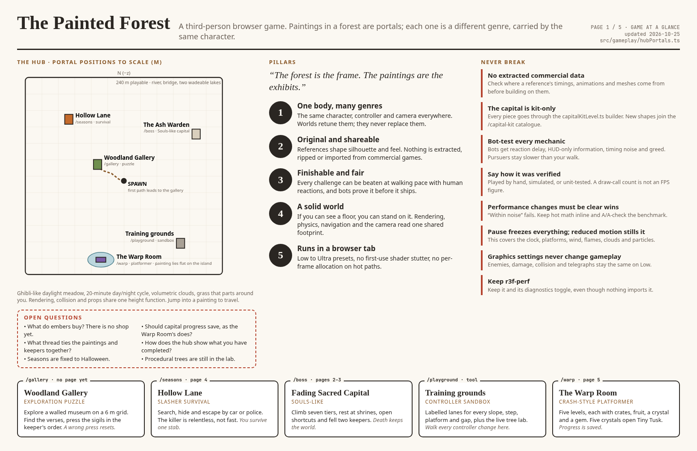
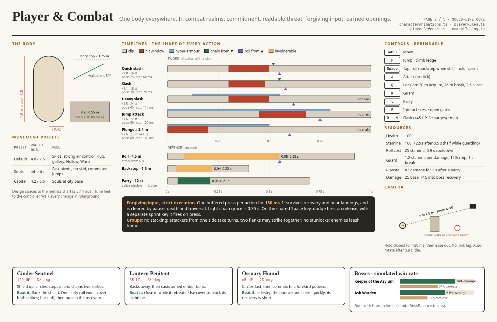
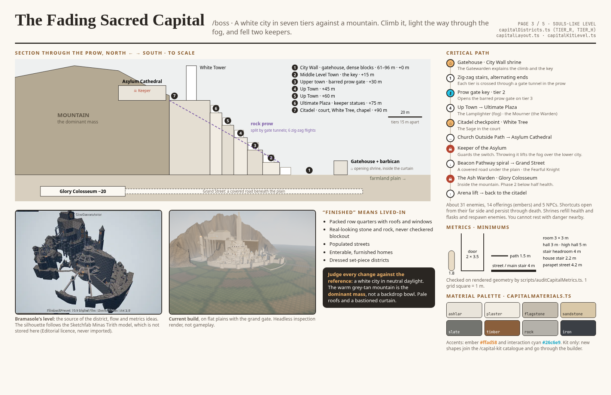
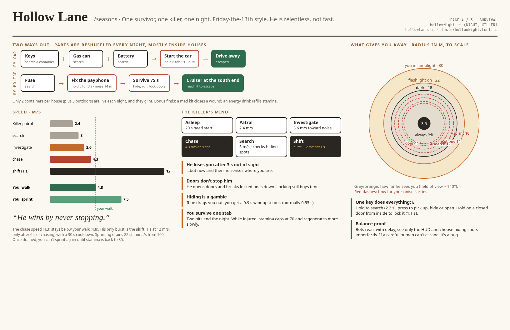
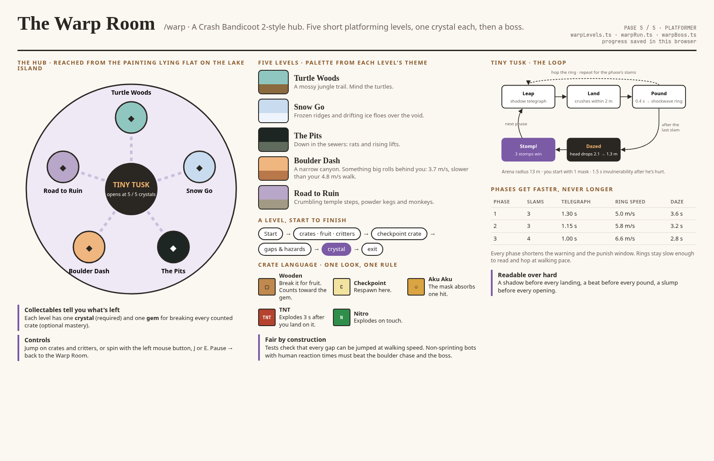

# One-page designs

The game's design is kept as one poster per area, following Stone Librande's
GDC talk on one-page designs. Each page is meant to be hung on a wall and read
at a glance, so they are mostly diagrams: maps, sections, timelines and loops,
with text only as callouts. They replace the long design bible.

| Page                                                    | Covers                                                                                                 |
| ------------------------------------------------------- | ------------------------------------------------------------------------------------------------------ |
| [1 · The Painted Forest](01-the-painted-forest.html)    | Hub map, pillars, the rules we never break, the worlds, open questions                                 |
| [2 · Player and combat](02-player-and-combat.html)      | Body metrics, movement presets, sword and defence timelines, controls, enemies, boss win rates, camera |
| [3 · The Fading Sacred Capital](03-sacred-capital.html) | Tier section to scale, critical path, "finished" checklist, metrics, material palette                  |
| [4 · Hollow Lane](04-hollow-lane.html)                  | Escape routes, speed chart, the killer's states, detection and noise radii                             |
| [5 · The Warp Room](05-warp-room.html)                  | Hub, levels, crate language, Tiny Tusk loop and phases                                                 |

## Keeping them true

- Each page is a self-contained 17 × 11 in (tabloid) sheet. Open it in a
  browser and print it landscape with no margins.
- Every number comes from the source file named in the page header. When a
  value changes in the code, change the page in the same commit. The code is
  authoritative.
- One page per area. If a page fills up, cut text before adding a second page.
- Regenerate the PNG previews with any headless browser at a 1632 × 1056
  viewport.
